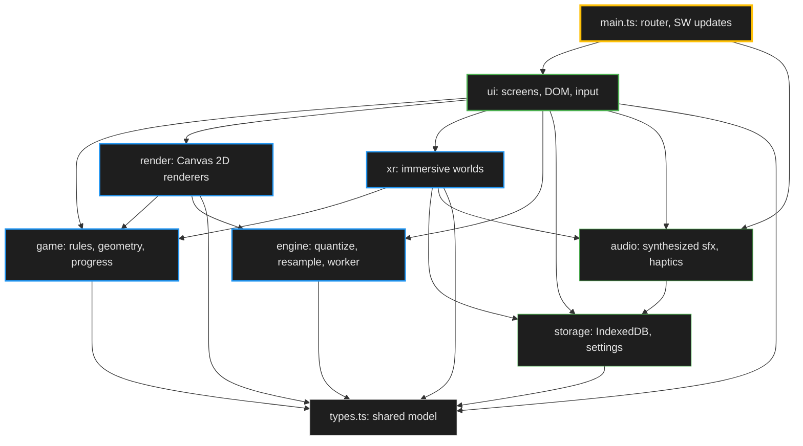
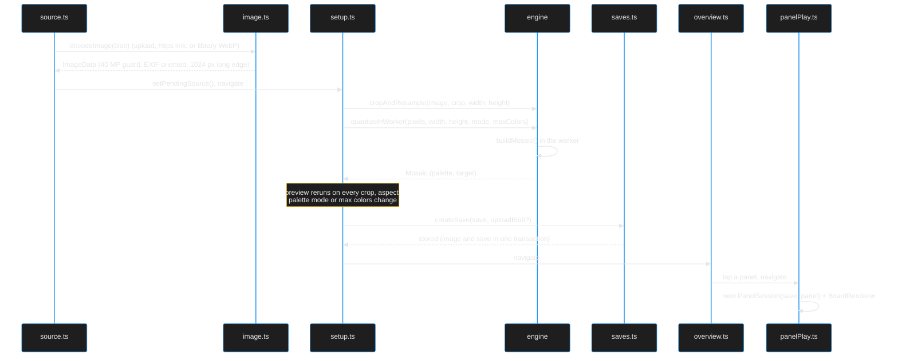

# Architecture

How par-dots is organized: the source layers, how a photo becomes a playable picture, the routes, what is persisted, and how the PWA updates. Read this before changing code; read [PRD.md](../PRD.md) for what the game does.

## Table of Contents

- [Overview](#overview)
- [Layers](#layers)
- [New-Picture Pipeline](#new-picture-pipeline)
- [Routes and Screens](#routes-and-screens)
- [Panel Play Screen](#panel-play-screen)
- [XR Entry](#xr-entry-p0p4)
- [Persistence](#persistence)
- [PWA and Updates](#pwa-and-updates)
- [Conventions](#conventions)
- [Where to Start Reading](#where-to-start-reading)
- [Related Documentation](#related-documentation)

## Overview

par-dots is a static, backend-free single-page app built with Vite and TypeScript, with no UI framework. Screens are plain DOM built by a small `h()` helper, the boards are drawn on Canvas 2D, image quantization runs in a Web Worker, and all state lives on the device in IndexedDB and localStorage. `src/main.ts` is the entry point: it owns the hash router and the service-worker update policy, and reports one GA4 page view per route render via `src/analytics.ts`.

## Layers

Dependencies point one way. `ui/` sits on top; the lower layers never import `ui/`, and `engine/`, `game/` and `storage/` import only `src/types.ts` and their own siblings.

| Directory | Owns | Notes |
| --- | --- | --- |
| `src/types.ts` | `Mosaic`, `PictureSave`, `PaletteColor`, `LAYOUT`, `EMPTY`, color limits | The shared model every layer imports |
| `src/engine/` | Image math: crop and area-average resample (`resample.ts`), quantization (`quantize.ts`), Lab color math (`color.ts`), the LEGO color table (`legoPalette.ts`), free-color shade names (`colorNames.ts`), the quantize worker and its client | DOM-free; runs in a worker or on the main thread |
| `src/game/` | Panel geometry (`geometry.ts`), per-panel rules and undo/redo (`panelSession.ts`), progress (`progress.ts`) | DOM-free; `PanelSession` mutates `save.placed` in place and emits events |
| `src/render/` | `BoardRenderer` (one 16x16 panel), `OverviewRenderer` (the whole picture), offscreen mosaic images, building sheets (per-panel pages plus the guide's overview, frame and assembly pages) and a minimal PDF writer (`pdf.ts`), sprites, layout math, shared canvas helpers | Knows nothing about screens; `render/color.ts` reuses `engine/color.ts` |
| `src/xr/` | WebXR session detection and immersive worlds (`session.ts` three.js-free, `scene.ts` the renderer owner) | Dynamically imported by panel play and the gallery; panel play prewarms XR chunks when `navigator.xr` exists |
| `src/storage/` | IndexedDB (`db.ts`), save validation and migration (`migrate.ts`), settings (`settings.ts`), storage persistence and quota (`quota.ts`), id generation (`id.ts`) | `ui/` reaches `db.ts` only through `src/ui/saves.ts` |
| `src/audio/` | Web Audio sounds and `navigator.vibrate` haptics (`sfx.ts`), looping background music from `public/music/*.mp3` (`music.ts`) | Reads settings on every call; music starts on the first gesture and pauses while hidden outside immersive sessions |
| `src/ui/` | Screens, DOM helpers, input handling, the save repository, navigation handoff state | Owns screens; render and XR modules also create canvases |

The Parts sheet's Buy parts section builds its wanted-list manifests in DOM-free `src/ui/manifests.ts` (BrickLink wanted-list XML and Rebrickable part-list CSV, with the LEGO color name to BrickLink/Rebrickable color ID tables). Each export covers the colored dots plus the mounting kit — one black canvas per panel, Technic pins per shared edge, two wall-mount hangers and, unless the builder opts out, a raised frame (`frameItems()`: a backing plate one stud larger than the panel grid, with a brick ring, plate layer and tile cap stacked on its border) — and is offered only in LEGO palette mode, where every color has a catalog ID. The builders are DOM-free, so they are unit-tested without a DOM.

## New-Picture Pipeline

A picture is created on two screens. The source screen decodes the chosen image; the setup screen crops, resamples and quantizes it, then writes the save. When the decoded image has transparency, the setup screen also offers a background color (default black) that transparent pixels are composited over before quantization.

Draw mode bypasses this pipeline: the "Make my own" card on the source screen opens `ui/drawCreate.ts` (name, aspect, size, palette mode, background), which writes a save with `origin: 'drawn'`, `target` all-empty, and an optional `drawBackground`. The editor screen `ui/drawEditor.ts` renders the whole mosaic with `render/drawBoard.ts` (seams, grid overlay, shape preview) and binds pointer input through `ui/drawInput.ts` (hover ghosts the cells a tool will paint; Shift+drag pans); DOM-free siblings `game/drawTools.ts` (rasterizers) and `game/drawSession.ts` (tool state, palette editing, undo/redo to 50, usage counts) own the rules, so `PanelSession`, `trayModel` and play rules are untouched. The editor persists on a 500 ms debounce flushed on cleanup, hide, and `pagehide`. Cross-links: `#/draw/:photoId` redirects to the overview; `#/play/:drawnId` redirects to the editor.

- `src/ui/image.ts` reads the image header with `readImageSize()` (`src/ui/imageHeader.ts`) and rejects more than `MAX_SOURCE_PIXELS` (40 MP) before `createImageBitmap` allocates the pixels.
- `src/engine/client.ts` falls back to running `buildMosaic()` on the main thread when workers are unavailable, when the worker crashes, or when a job takes longer than `QUANTIZE_TIMEOUT_MS` (20 s).
- `buildMosaic()` in `src/engine/quantize.ts` is deterministic: LEGO mode picks colors from `LEGO_COLORS` by greedy selection and swap refinement when more LEGO colors are in play than the limit allows; free mode runs seeded k-means++ and Lloyd iterations in Lab when the image has more distinct colors than the limit. Both then merge colors closer than `MIN_DELTA_E` and sort the palette by lightness.
- Panel geometry lives in `src/game/geometry.ts`, the single owner. At creation, a named aspect plus a size scale (1–3, `SIZE_OPTIONS` in `src/types.ts`) or a custom typed grid (1×1–10×10, `PANEL_GRID_MIN`/`PANEL_GRID_MAX`) picks the panel grid; the save's own `width`/`height` encode the grid, every save-backed consumer derives it with `gridOfDims()`, and the aspect stored on the save is a display label (the nearest named aspect for custom grids).

## Routes and Screens

`src/main.ts` listens for `hashchange`, parses the hash with `parseRoute()` (`src/ui/pure.ts`), and mounts one screen, after initializing the delegated tooltip chip (`src/ui/tooltips.ts`: any element with a `data-tip` attribute gets a styled chip on hover or focus, replacing native `title` tooltips). Every screen follows the same contract from `src/ui/screen.ts`: `mount(ctx, ...params)` builds DOM into `ctx.root` and returns a `Cleanup` that the router calls before mounting the next screen. The router also closes every open sheet and celebration through the overlay registry in `src/ui/dom.ts`.

| Hash | Route | Mount function | File |
| --- | --- | --- | --- |
| `#/` | `gallery` | `mountGallery` | `src/ui/gallery.ts` |
| `#/new` | `new` | `mountSource` | `src/ui/source.ts` |
| `#/setup` | `setup` | `mountSetup` | `src/ui/setup.ts` |
| `#/draw/new` | `drawNew` | `mountDrawCreate` | `src/ui/drawCreate.ts` |
| `#/draw/:id` | `drawEditor` | `mountDrawEditor` | `src/ui/drawEditor.ts` |
| `#/play/:id` | `overview` | `mountOverview` | `src/ui/overview.ts` |
| `#/play/:id/:panel` | `panel` | `mountPanelPlay` | `src/ui/panelPlay.ts` |

Any other hash, including one with a malformed percent-escape, falls back to the gallery. `#/setup` depends on in-memory handoff state (`setPendingSource` in `src/ui/state.ts`), so opening it directly redirects to `#/new`. `src/ui/state.ts` also carries the transition hint that lets the overview zoom out from the panel just left and show the finale.

## Panel Play Screen

`src/ui/panelPlay.ts` is wiring: it loads the save, builds the view, and connects modules that each own one concern.

| Module | Owns |
| --- | --- |
| `src/game/panelSession.ts` | Rules for one panel: strokes, tray colors, undo/redo (10 moves), completion, change events |
| `src/ui/playView.ts` | Static DOM for the screen and the color tray view |
| `src/ui/gestures.ts` | DOM-free pointer model: touch hold, pinch grace, pan mode, turning pointers into stroke, pan and zoom intents |
| `src/ui/boardInput.ts` | Binds canvas pointer and wheel events to the gesture model and applies pan and zoom to the renderer viewport |
| `src/ui/panelTimer.ts` | Visible-time accounting per panel |
| `src/ui/trayModel.ts` | Tray diffing and remaining counts |
| `src/ui/playFeedback.ts` | Sounds, haptics and cell redraws driven by `PanelSession` events, including the full-but-wrong buzz |
| `src/render/boardRenderer.ts` | Drawing the 16x16 board, hit testing, placement highlights, reversible reference fades, hints, and the completion sweep |

Game rules stay in `game/`: `ui/` never decides whether a dot is correct, it asks `PanelSession`.

`engine/colorNames.ts` describes Free colors from their RGB shade. Quantization stores those names for new pictures, while `paletteLabels(palette, mode)` derives them for existing Free pictures when the tray, Parts, or building guides are rendered. LEGO labels stay intact. Display relabeling never mutates saves or changes palette indices, target cells, or placed cells.

Visual effects do not delay game-state updates. The renderer runs its animation loop only while an effect is active and resolves a pending completion sweep when destroyed. Panel play waits for that sweep before showing the board-local badge in `celebrate.ts`; full-screen confetti is used only by the picture finale. The tray owns transient selection, count, and completed-color feedback and disposes its animation resources on unmount. Reduced motion skips movement while retaining the resulting state and completion message.

## XR Entry (P0–P4)

The "Enter VR" / "Enter MR" chips on panel play are WebXR entries (spec: [PRD-XR.md](../PRD-XR.md)). They appear only after `navigator.xr` reports support for the respective mode. `src/xr/session.ts` (no three.js) detects support and requests `immersive-vr` or `immersive-ar`, with `local-floor` as an optional feature; MR also requests optional hit testing. `src/xr/scene.ts` (the renderer owner) builds the VR studio — void background, grid floor, neutral lights — or the alpha-clear passthrough studio for MR, binds the session via `renderer.xr.setSession()`, and on the session's `end` event stops the loop, disposes the world's GPU resources, and hands control back so panel play saves panel state, saves the layout in VR, and re-enables the buttons.

The gallery also launches XR into an unfinished-picture library with previews, controller hover feedback and thumbstick paging; gallery-launched VR panel worlds save their layout on exit or panel change, and show an in-world update notice while immersive. When MR hit testing is available, placement requires a current hit-test result; otherwise the workspace appears at the default position.

MR hit testing uses the active controller's target-ray space, with stale sources canceled on controller changes. `magnifier.ts`, `overview.ts` and `physicalGuide.ts` provide optional workspace surfaces, while the plate renders selected-color focus. The picture overview asks the UI owner to swap panel worlds. `draw.ts` uses a separate `DrawSession` world for drawings, preserving the draw editor's save and undo semantics. The gallery's transfer guide describes the existing backup import/export as copies rather than synchronization.

Inside a session, `src/xr/world.ts` assembles the workspace: `plate.ts` (16x16 studs on an 8 mm pitch, enlarged for readability, as one InstancedMesh fed straight from `placed`), `frame.ts` (CanvasTexture reference face with the building-sheet symbols and the Overlay toggle), `tray.ts` (chips mirroring the 2D tray semantics through the same `PanelSession`, with count labels sized to each chip), `tools.ts` (labeled Place/Remove/Hint/Undo/Redo/Ghost/Help/Settings icons with active-state highlights), and `input.ts` (pure trigger/A/B model: tap places, A+sweep paints one move, B exits). `bridge.ts` is the only file touching game state — it wraps the 2D panel session so XR strokes take the identical code path — and `place.ts` holds the MR hit-test reticle math. Either grip independently grabs the plate, frame, tray, tool panel or whole-picture view and follows the controller's position and full orientation. Each grip marker changes color near a grabbable object; controller slots follow WebXR connection events, and the gallery uses the same controller visuals and B-to-exit input. The reference frame maps controller rays to target colors for tray selection, and the plate can render target colors and symbols on empty pegs, with a reusable ring marking the current target without recoloring it. `settings.ts` controls shared audio and haptic settings plus the persistent VR world selection; `environment.ts` owns the VR backdrop, while MR remains passthrough. A frame-attached label shows correct-dot progress. A completion card plays the panel fanfare and lets players continue to the next plate without leaving XR. `transforms.ts` owns the rotating local grab offset, time-based stick yaw, push/pull and scale, +Y tray facing, and inverse-matrix ray conversion. While gripping, the same controller's thumbstick left/right rotates the held object and up/down pushes it away or pulls it closer along the laser beam. Holding the trigger too changes up/down to scaling (0.4x–3x). `input.ts` reads xr-standard thumbstick axes 2/3. `layout.ts` persists each panel's workspace transforms on session end (`xrLayouts` on the save record, schema still v2) and VR entry restores them. A separate validated localStorage record stores a reusable custom layout, including tools and picture transforms. The picture view remains available while placing dots and carries its pose across panel swaps. The gallery panel starts upright and can also be grip-moved. Panel play and the gallery dynamically import the XR world; panel play prewarms it when the browser exposes WebXR, and creates a world only on session entry.

## Persistence

| Store | Where | Contents |
| --- | --- | --- |
| IndexedDB `par-dots`, version 1, store `saves` | `src/storage/db.ts` | `PictureSave` records, keyPath `id` |
| IndexedDB `par-dots`, store `images` | `src/storage/db.ts` | Uploaded image blobs, keyed by the save's `sourceImageId`; library pictures use `library:<slug>` and have no blob |
| localStorage `par-dots:xr-custom-layouts` | `src/xr/layout.ts` | Reusable custom XR workspace layout on this device |
| localStorage `par-dots:settings` | `src/storage/settings.ts` | `Settings` (sound, place sound, haptics, music and track, effects and music volume, palette mode, max colors, dither, 2D background, VR environment, snap radius and magnifier), cached in memory |
| localStorage `par-dots:install-prompt-dismissed` | `src/ui/install.ts` | Whether the one-time install prompt was shown |

- `src/ui/saves.ts` is the save repository and the only persistence entry point for `ui/`. It keeps one in-memory object per save id, so the overview and panel play share the same `placed` array.
- New uploads go through `createSave(save, blob)`, which writes the image and the save in one transaction (`putSaveWithImage`). A quota error surfaces as `StorageFullError`.
- Panel play writes the save at the end of each stroke, after undo/redo, when the page is hidden, on unmount, and when the panel completes.
- Every read passes through `migrateSave()` in `src/storage/migrate.ts`, which validates the shape against `LAYOUT` and the palette and stamps `schemaVersion`. Records that are malformed or come from a newer build are skipped with a warning.
- Backups (`src/storage/backup.ts`) are one JSON document (`format: 'par-dots-backup'`, `version: 1`) holding each save with base64 `target`/`placed` and, for uploads, the base64 image. Import caps a file at 200 MB and 200 saves and each image at 20 MB, runs every save through `migrateSave()`, drops invalid ones, and writes each as a new save with fresh save and image ids, so a restore never overwrites existing progress.
- To change the save shape, bump `SAVE_SCHEMA_VERSION` in `src/types.ts` and add the upgrade step to `migrateSave()`. The IndexedDB `DB_VERSION` only needs to change when object stores or indexes change.

## PWA and Updates

`vite-plugin-pwa` generates the service worker and manifest from `vite.config.ts`.

- **Precache:** every built `html`, `css`, `js`, `svg`, `png`, `webp`, `json`, `webmanifest` and `mp3` file (the file-size cap is raised to 8 MB for the music), which includes the bundled library in `public/library/` and its `manifest.json`, plus the favicons, the Apple touch icon and `CNAME`. After the first load, the app plays fully offline.
- **Registration:** `registerType: 'prompt'`, so a new deploy waits instead of reloading tabs on its own.
- **Update checks:** `watchForUpdates()` in `src/ui/swUpdate.ts` checks for a new deploy immediately, every 5 minutes (`UPDATE_CHECK_MS`), and whenever the page becomes visible. Each check also fetches `/version.json` with `cache: 'no-store'`; the build plugin in `vite.config.ts` emits that manifest with a deterministic SHA-256 content hash of the whole bundle. A different fingerprint asks the service worker to update (the registration uses `updateViaCache: 'none'`, so the worker script itself bypasses the HTTP cache) or, on a first visit with no controlling worker, offers a reload.
- **Applying an update:** `src/updateState.ts` coordinates the 2D and XR notices. When the player selects Reload, it ends any immersive session, flushes registered active saves and waits for pending writes before activating the worker and reloading. Picture setup requires confirmation because its current changes are not saved. A worker activated by another tab also offers a reload instead of interrupting play.
- **Content Security Policy:** the production build injects a CSP `<meta>` tag. Everything is `'self'`; GA4 (`src/analytics.ts`) and the Cloudflare beacon are the only external scripts, so `script-src` additionally allows `*.googletagmanager.com` and `static.cloudflareinsights.com`, and `connect-src 'self' https:` covers the user's image links. The dev server omits it because Vite needs inline scripts and an HMR socket. `index.html` sets `referrer` to `no-referrer`.

## Conventions

- **Imports by file path.** `src/game/index.ts` is the one barrel, because `game/` exposes a cohesive API (session, geometry, progress). Other directories are imported by file path, and `render/overviewRenderer.ts` imports `game/geometry.ts` directly. Add a barrel only when a directory grows a similarly cohesive public API.
- **Screen contract.** `mount*` returns a `Cleanup`; async work checks an `alive` flag before touching the DOM after an await.
- **DOM construction.** Build elements with `h()`, `icon()` and `iconButton()` from `src/ui/dom.ts`. They set attributes and text only, never HTML strings.
- **Overlays.** Sheets, dialogs and celebrations register with `registerOverlay()` so the router and the Escape key can close them.
- **Pure helpers.** Logic that does not need the DOM (routing, crop math, formatting, gestures, timers, tray diffs) lives in DOM-free modules with unit tests in `tests/`.
- **Errors shown to the player** go through `userMessage()` in `src/ui/pure.ts`.

## Where to Start Reading

1. `src/types.ts` for the data model.
2. `src/main.ts` for routing and updates.
3. `src/game/panelSession.ts` for the rules.
4. `src/ui/setup.ts` and `src/engine/quantize.ts` for picture creation.
5. `src/ui/panelPlay.ts` for how play is wired together.

## Related Documentation

- [PRD.md](../PRD.md) - Product requirements and behavior as built
- [README.md](../README.md) - Setup, commands and contributing
- [DEPLOYMENT.md](DEPLOYMENT.md) - Build, deploy, verification and rollback
- [DOCUMENTATION_STYLE_GUIDE.md](DOCUMENTATION_STYLE_GUIDE.md) - How to write docs in this repository
